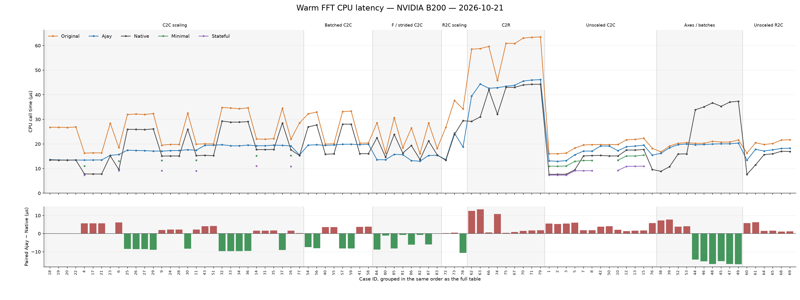

# Warm FFT comparison

Compare the public CuPy FFT paths with a minimal cached nvmath lifecycle.

| Row | What it measures | Definition |
| --- | --- | --- |
| Original | CuPy's nvmath adapter, including compiled stride conversion and cached dtype names. | [`_try_use_nvmath`](../../cupy/fft/_fft_nvmath.py#L222) |
| Ajay | Original plus common-axis shortcuts and normalization fused into the FFT output store. | [`_try_use_nvmath_ajay`](../../cupy/fft/_fft_nvmath.py#L357), [`_compile_normalization_epilog`](../../cupy/fft/_fft_nvmath.py#L147) |
| Native | Public `cupy.fft` with nvmath disabled, using CuPy's cached cuFFT plans. | [`cupy/fft/_fft.py`](../../cupy/fft/_fft.py); selected in [`main.py`](main.py) |
| Stateful | Repeated direct `FFT.execute()` on a separately planned, continuously bound operand; no key, cache lookup or rebinding. Forward C2C only. | `stateful.execute` in [`main.py`](main.py) |
| Minimal | Fresh metadata key, dictionary lookup, operand binding, forward execution and operand release. Forward C2C only. | [`execute_cached`](minimal_lifecycle.py#L18) |

Original, Ajay and Minimal use the same execute candidate. Unscaled
requests share a cached plan; scaled Ajay requests use separate plans with
normalization compiled into the store callback on a cache miss. Stateful
uses that candidate on its own bound object. Native uses its own plans.
Operands and requests are in [`cases.py`](cases.py).

The adapter computes the normalization divisor, defines a small Python
scaling function and compiles it with nvmath's documented `compile_epilog`
API on a plan miss. The returned code is passed to `plan(epilog=...)`.
Warm plan hits reuse that plan without compiling or separately scaling
the output. This follows nvmath's existing normalization example and
requires its optional Numba dependencies; no nvmath source changes are needed.

## Replicate

With a working CUDA 13 build environment, clone and install both sources:

```sh
git clone --recurse-submodules --branch ajay/fft-adapter-request-benchmark \
  https://github.com/yangcal/cupy.git cupy-fft-request
git clone --branch ajay/fft-cache-lifecycle \
  ssh://git@gitlab-master.nvidia.com:12051/cuda-hpc-libraries/python/nvmath-python.git \
  nvmath-fft-request
git -C nvmath-fft-request checkout --detach \
  84d59bc0fa8128142669ec9586537f5bba169254

python -m pip install 'setuptools>=77.0.3' wheel 'Cython==3.2.9' 'numpy<2.5'
python -m pip install --no-build-isolation -e './nvmath-fft-request[sysctk13,numba]'
CUPY_USE_CUDA_PYTHON=1 PYTHONPATH="$PWD/nvmath-fft-request" \
  python -m pip install --no-build-isolation -e ./cupy-fft-request
cd cupy-fft-request
```

The nvmath checkout contains the execute/workspace candidate and requires
internal repository access. For general source-build setup, see
[CuPy installation](../../docs/source/install.rst).

Run a short three-operand check, then the full 87-case sweep:

```sh
python -P benchmarks/fft_nvmath_adapter/main.py --suite basic \
  --repeats 20 --warmups 5 --json smoke.json
python -P benchmarks/fft_nvmath_adapter/main.py --json results.json
```

Use `--list-cases` to inspect the requests or `--case SUBSTRING` to select
cases. Defaults are 30 balanced blocks, 500 samples and 20 warmups per row.
Planning and validation are outside timing; nvmath workspace is retained.
Raw samples, environment and source hashes are saved in JSON. The five-row
cases use a balanced ten-order design repeated three times; other cases use
all six permutations five times.

Both CPU call times and CUDA-event elapsed times are printed and summarized
in JSON as `rows_cpu_us` and `rows_gpu_us`, with paired differences for each.
CUDA events bracket the complete public call and include host submission
gaps; they do not isolate FFT kernel time.

JSON also records the first plan's construction, `compile_epilog` and
planning host times during setup, separately from the warm samples.
These are individual observations affected by compiler first use and
driver caches. Execution is excluded from those preparation intervals;
the collection wrappers are removed before warm timing.

## Results

This run validates the documented `compile_epilog` implementation. Ajay
retains the earlier common-axis shortcuts. The earlier scaling shortcut
only skipped setup when no scaling was needed; scaled requests still
launched a separate CuPy division. Ajay now performs that division in the
FFT output store, removing the separate scaling launch and output pass.

NVIDIA B200 warm CPU call times in microseconds, measured with  
`cupyx.profiler.benchmark` on 2026-10-21. Values are medians of block  
medians from 30 balanced blocks, with 500 samples per row per block.  
Planning and validation are outside timing. These are host call times,  
not isolated GPU kernel times.  
Savings use paired block differences and need not equal subtraction of  
the independently aggregated table entries.

Historical context, CPU time in µs: the earlier Ajay column is the
2026-10-20 axes/no-op-scaling implementation. Current Ajay and Native are
from this run. These are separate B200 allocations with NumPy 2.5.4 and
2.4.6 respectively, rather than an isolated measurement of fusion alone.

| Request | Earlier Ajay | Current Ajay | Current Native |
| --- | ---: | ---: | ---: |
| `fft`, `(1024,)`, `ortho` | 25.89 | 13.50 | 13.43 |
| `fftn`, `(32,32)`, `forward` | 30.83 | 17.49 | 25.94 |
| `ifftn`, `(16,16,16)`, `ortho` | 33.57 | 19.55 | 29.07 |
| `irfftn`, input `(4,8,9)`, default norm | 61.32 | 45.58 | 43.99 |

Tiny forward C2C transforms (complex64, C-contiguous), CPU time in µs:

| Operand | Stateful | Minimal | Original | Ajay | Native |
| --- | ---: | ---: | ---: | ---: | ---: |
| `(2,)` | 7.34 | 10.97 | 15.99 | 13.12 | 7.64 |
| `(2,2)` | 9.11 | 13.26 | 19.59 | 17.11 | 15.15 |
| `(2,2,2)` | 10.90 | 15.09 | 21.70 | 18.90 | 17.53 |

The paired Ajay overhead above Minimal is 2.14 / 3.90 / 3.80 µs for these
1D / 2D / 3D requests.

### CUDA-event validation

Representative CUDA-event times in µs, from the same samples as the CPU
results. Events include host submission gaps, copies and scaling; these
are complete stream intervals, not isolated FFT kernel timings.

| Request | Original | Ajay | Native |
| --- | ---: | ---: | ---: |
| `fft`, `(1024,)`, `ortho` | 29.22 | 17.22 | 16.96 |
| `fftn`, `(32,32)`, `forward` | 34.45 | 21.22 | 28.38 |
| `ifftn`, `(16,16,16)`, `ortho` | 37.13 | 22.02 | 31.52 |
| `ifft`, `(1048576,)`, default norm | 37.78 | 31.52 | 29.41 |
| `rfft`, `(1048575,)`, `ortho` | 67.10 | 62.96 | 58.31 |
| `ifft2`, `(4,256,512)`, default norm | 35.68 | 26.02 | 32.32 |
| `ifft2`, `(4,256,512)`, `ortho` | 35.90 | 29.81 | 32.32 |
| `irfft`, input `(524289,)`, default norm | 64.81 | 55.52 | 43.71 |
| `irfftn`, input `(64,64,33)`, `ortho` | 66.24 | 51.64 | 46.98 |

Callback compilation took 1.18 s on first use in the sweep. The remaining
34 scaled plan misses took 8.22–42.12 ms to compile, with a 12.01 ms median.
Scaled Ajay planning intervals ranged from 25.47 to 592.20 ms. These are
individual setup observations outside the warm samples, not a repeated
cold-path benchmark.

### Full results

Scaling-heavy operand families appear first, followed by C2R's remaining
input-preservation work and unscaled requests. Related requests for the same
operand stay together, including their unscaled controls. IDs remain the
original case IDs used in the graph below.

#### C2C normalization — contiguous operands

| ID | Request | Operand | Native | Original | Ajay | Minimal | Stateful |
| ---: | --- | --- | ---: | ---: | ---: | ---: | ---: |
| 18 | `fft(a, axis=-1, norm='forward')` | `(1024,)` complex64 C | 13.453 | 26.802 | 13.637 | — | — |
| 19 | `fft(a, axis=-1, norm='ortho')` | `(1024,)` complex64 C | 13.427 | 26.788 | 13.497 | — | — |
| 20 | `ifft(a, axis=-1, norm=None)` | `(1024,)` complex64 C | 13.415 | 26.686 | 13.447 | — | — |
| 22 | `ifft(a, axis=-1, norm='ortho')` | `(1024,)` complex64 C | 13.459 | 26.914 | 13.459 | — | — |
| 4 | `fft(a, axis=-1)` | `(1024,)` complex64 C | 7.818 | 16.284 | 13.436 | 11.011 | 7.323 |
| 17 | `fft(a, axis=-1, norm='backward')` | `(1024,)` complex64 C | 7.793 | 16.377 | 13.488 | — | — |
| 21 | `ifft(a, axis=-1, norm='forward')` | `(1024,)` complex64 C | 7.782 | 16.376 | 13.513 | — | — |
| 23 | `ifft(a, axis=-1)` | `(1048576,)` complex64 C | 15.158 | 28.427 | 15.357 | — | — |
| 6 | `fft(a, axis=-1)` | `(1048576,)` complex64 C | 9.578 | 18.519 | 15.699 | 13.001 | 9.132 |
| 25 | `fftn(a, axes=(0, 1), norm='forward')` | `(32, 32)` complex64 C | 25.943 | 31.966 | 17.495 | — | — |
| 26 | `fftn(a, axes=(0, 1), norm='ortho')` | `(32, 32)` complex64 C | 25.923 | 32.156 | 17.342 | — | — |
| 27 | `ifftn(a, axes=(0, 1), norm=None)` | `(32, 32)` complex64 C | 25.835 | 31.969 | 17.278 | — | — |
| 29 | `ifftn(a, axes=(0, 1), norm='ortho')` | `(32, 32)` complex64 C | 26.102 | 32.369 | 17.132 | — | — |
| 9 | `fftn(a, axes=(0, 1))` | `(32, 32)` complex64 C | 15.080 | 19.486 | 17.070 | 13.301 | 9.143 |
| 24 | `fftn(a, axes=(0, 1), norm='backward')` | `(32, 32)` complex64 C | 15.121 | 19.841 | 17.309 | — | — |
| 28 | `ifftn(a, axes=(0, 1), norm='forward')` | `(32, 32)` complex64 C | 15.123 | 19.793 | 17.336 | — | — |
| 30 | `ifftn(a, axes=(0, 1))` | `(1024, 1024)` complex64 C | 25.984 | 32.535 | 17.661 | — | — |
| 11 | `fftn(a, axes=(0, 1))` | `(1024, 1024)` complex64 C | 15.252 | 19.915 | 17.464 | 13.426 | 9.035 |
| 43 | `fftn(a, axes=(1, 0))` | `(1024, 1024)` complex64 C | 15.379 | 20.056 | 19.447 | — | — |
| 51 | `fftn(a, axes=(0, -1))` | `(1024, 1024)` complex64 C | 15.246 | 20.024 | 19.500 | — | — |
| 32 | `fftn(a, axes=(0, 1, 2), norm='forward')` | `(16, 16, 16)` complex64 C | 29.299 | 34.839 | 19.681 | — | — |
| 33 | `fftn(a, axes=(0, 1, 2), norm='ortho')` | `(16, 16, 16)` complex64 C | 28.868 | 34.620 | 19.270 | — | — |
| 34 | `ifftn(a, axes=(0, 1, 2), norm=None)` | `(16, 16, 16)` complex64 C | 28.888 | 34.309 | 19.226 | — | — |
| 36 | `ifftn(a, axes=(0, 1, 2), norm='ortho')` | `(16, 16, 16)` complex64 C | 29.069 | 34.676 | 19.548 | — | — |
| 14 | `fftn(a, axes=(0, 1, 2))` | `(16, 16, 16)` complex64 C | 17.700 | 22.031 | 19.258 | 15.240 | 11.070 |
| 31 | `fftn(a, axes=(0, 1, 2), norm='backward')` | `(16, 16, 16)` complex64 C | 17.708 | 21.929 | 19.280 | — | — |
| 35 | `ifftn(a, axes=(0, 1, 2), norm='forward')` | `(16, 16, 16)` complex64 C | 17.765 | 22.161 | 19.513 | — | — |
| 37 | `ifftn(a, axes=(0, 1, 2))` | `(128, 64, 128)` complex64 C | 28.503 | 34.488 | 19.419 | — | — |
| 16 | `fftn(a, axes=(0, 1, 2))` | `(128, 64, 128)` complex64 C | 17.613 | 21.956 | 19.209 | 15.253 | 10.899 |
| 77 | `ifft(a, norm=None)` | `(65536,)` complex128 C | 15.280 | 28.579 | 15.543 | — | — |

#### Batched C2C normalization

| ID | Request | Operand | Native | Original | Ajay | Minimal | Stateful |
| ---: | --- | --- | ---: | ---: | ---: | ---: | ---: |
| 54 | `ifft2(a, norm=None)` | `(2, 8, 16)` complex64 C | 26.952 | 32.249 | 19.508 | — | — |
| 56 | `ifft2(a, norm='ortho')` | `(2, 8, 16)` complex64 C | 27.709 | 32.963 | 19.688 | — | — |
| 40 | `fft2(a)` | `(2, 8, 16)` complex64 C | 15.817 | 19.952 | 19.406 | — | — |
| 55 | `ifft2(a, norm='forward')` | `(2, 8, 16)` complex64 C | 15.988 | 20.116 | 19.591 | — | — |
| 57 | `ifft2(a, norm=None)` | `(4, 256, 512)` complex64 C | 28.058 | 33.140 | 19.868 | — | — |
| 59 | `ifft2(a, norm='ortho')` | `(4, 256, 512)` complex64 C | 28.049 | 33.375 | 19.909 | — | — |
| 41 | `fft2(a)` | `(4, 256, 512)` complex64 C | 16.042 | 20.328 | 19.722 | — | — |
| 58 | `ifft2(a, norm='forward')` | `(4, 256, 512)` complex64 C | 16.051 | 20.396 | 19.885 | — | — |

#### C2C normalization — Fortran and strided operands

| ID | Request | Operand | Native | Original | Ajay | Minimal | Stateful |
| ---: | --- | --- | ---: | ---: | ---: | ---: | ---: |
| 84 | `ifft(a)` | `(8, 16)` complex64 F | 22.516 | 28.611 | 13.608 | — | — |
| 80 | `fft(a)` | `(8, 16)` complex64 F | 14.626 | 16.378 | 13.585 | — | — |
| 85 | `ifft(a)` | `(16, 65536)` complex64 F | 23.888 | 30.657 | 15.777 | — | — |
| 81 | `fft(a)` | `(16, 65536)` complex64 F | 16.289 | 18.451 | 15.639 | — | — |
| 86 | `ifft(a)` | `(64,)` complex64 strided | 19.345 | 26.466 | 13.220 | — | — |
| 82 | `fft(a)` | `(64,)` complex64 strided | 13.673 | 16.092 | 12.984 | — | — |
| 87 | `ifft(a)` | `(1048576,)` complex64 strided | 21.212 | 28.547 | 15.313 | — | — |
| 83 | `fft(a)` | `(1048576,)` complex64 strided | 15.562 | 18.193 | 15.405 | — | — |

#### R2C normalization

| ID | Request | Operand | Native | Original | Ajay | Minimal | Stateful |
| ---: | --- | --- | ---: | ---: | ---: | ---: | ---: |
| 72 | `rfft(a, norm='forward')` | `(33,)` float32 C | 13.357 | 26.766 | 13.650 | — | — |
| 73 | `rfft(a, norm='ortho')` | `(1048575,)` float32 C | 23.862 | 37.679 | 24.402 | — | — |
| 78 | `rfftn(a, norm='forward')` | `(64, 64, 64)` float64 C | 29.436 | 34.214 | 18.777 | — | — |

#### C2R transforms — input preservation and normalization

| ID | Request | Operand | Native | Original | Ajay | Minimal | Stateful |
| ---: | --- | --- | ---: | ---: | ---: | ---: | ---: |
| 62 | `irfft(a)` | `(17,)` complex64 C | 29.184 | 58.520 | 39.484 | — | — |
| 63 | `irfft(a)` | `(524289,)` complex64 C | 31.015 | 58.776 | 44.358 | — | — |
| 66 | `irfft2(a)` | `(8, 9)` complex64 C | 42.005 | 59.651 | 42.623 | — | — |
| 74 | `irfft2(a, norm='forward')` | `(8, 9)` complex64 C | 32.117 | 45.791 | 42.878 | — | — |
| 75 | `irfft2(a, norm='ortho')` | `(512, 513)` complex64 C | 43.039 | 60.935 | 43.453 | — | — |
| 67 | `irfft2(a)` | `(1024, 513)` complex64 C | 43.020 | 60.813 | 43.859 | — | — |
| 70 | `irfftn(a)` | `(4, 8, 9)` complex64 C | 43.985 | 63.035 | 45.583 | — | — |
| 71 | `irfftn(a)` | `(128, 64, 65)` complex64 C | 44.247 | 63.357 | 45.982 | — | — |
| 79 | `irfftn(a, norm='ortho')` | `(64, 64, 33)` complex128 C | 44.277 | 63.520 | 46.162 | — | — |

#### Unscaled C2C — full transforms

| ID | Request | Operand | Native | Original | Ajay | Minimal | Stateful |
| ---: | --- | --- | ---: | ---: | ---: | ---: | ---: |
| 1 | `fft(a, axis=-1)` | `(2,)` complex64 C | 7.642 | 15.987 | 13.121 | 10.965 | 7.338 |
| 2 | `fft(a, axis=-1)` | `(8,)` complex64 C | 7.670 | 16.048 | 12.945 | 10.940 | 7.327 |
| 3 | `fft(a, axis=-1)` | `(64,)` complex64 C | 7.699 | 16.311 | 13.228 | 11.043 | 7.312 |
| 5 | `fft(a, axis=-1)` | `(65536,)` complex64 C | 9.500 | 18.322 | 15.590 | 12.928 | 9.122 |
| 7 | `fftn(a, axes=(0, 1))` | `(2, 2)` complex64 C | 15.146 | 19.589 | 17.106 | 13.255 | 9.105 |
| 8 | `fftn(a, axes=(0, 1))` | `(8, 8)` complex64 C | 15.282 | 19.719 | 17.104 | 13.291 | 9.132 |
| 42 | `fftn(a, axes=(1, 0))` | `(8, 16)` complex64 C | 15.344 | 19.757 | 19.197 | — | — |
| 50 | `fftn(a, axes=(0, -1))` | `(8, 16)` complex64 C | 15.136 | 19.714 | 19.138 | — | — |
| 10 | `fftn(a, axes=(0, 1))` | `(128, 128)` complex64 C | 15.130 | 19.761 | 17.260 | 13.430 | 9.224 |
| 12 | `fftn(a, axes=(0, 1, 2))` | `(2, 2, 2)` complex64 C | 17.532 | 21.700 | 18.896 | 15.093 | 10.902 |
| 13 | `fftn(a, axes=(0, 1, 2))` | `(4, 4, 4)` complex64 C | 17.507 | 21.850 | 19.144 | 15.123 | 10.914 |
| 15 | `fftn(a, axes=(0, 1, 2))` | `(64, 64, 64)` complex64 C | 17.756 | 22.299 | 19.493 | 15.458 | 10.972 |
| 76 | `fft(a, norm=None)` | `(1048576,)` complex128 C | 9.630 | 18.214 | 15.443 | — | — |

#### Unscaled C2C — batched and nonadjacent axes

| ID | Request | Operand | Native | Original | Ajay | Minimal | Stateful |
| ---: | --- | --- | ---: | ---: | ---: | ---: | ---: |
| 38 | `fftn(a, axes=(1,))` | `(3, 16)` complex64 C | 8.892 | 16.793 | 16.212 | — | — |
| 39 | `fftn(a, axes=(1,))` | `(16, 65536)` complex64 C | 10.756 | 19.140 | 18.451 | — | — |
| 52 | `fftn(a, axes=(2, 3))` | `(2, 3, 8, 16)` complex64 C | 15.914 | 20.276 | 19.748 | — | — |
| 53 | `fftn(a, axes=(2, 3))` | `(2, 4, 256, 512)` complex64 C | 15.964 | 20.557 | 19.988 | — | — |
| 44 | `fftn(a, axes=(0, 2))` | `(4, 3, 8)` complex64 C | 33.912 | 20.259 | 19.662 | — | — |
| 46 | `fftn(a, axes=[0, 2])` | `(4, 3, 8)` complex64 C | 35.063 | 20.285 | 19.768 | — | — |
| 48 | `fftn(a, axes=(np.int64(0), np.int64(2)))` | `(4, 3, 8)` complex64 C | 36.718 | 21.064 | 19.979 | — | — |
| 45 | `fftn(a, axes=(0, 2))` | `(128, 4, 1024)` complex64 C | 35.293 | 20.752 | 20.059 | — | — |
| 47 | `fftn(a, axes=[0, 2])` | `(128, 4, 1024)` complex64 C | 37.031 | 20.773 | 20.053 | — | — |
| 49 | `fftn(a, axes=(np.int64(0), np.int64(2)))` | `(128, 4, 1024)` complex64 C | 37.371 | 21.631 | 20.387 | — | — |

#### Unscaled R2C transforms

| ID | Request | Operand | Native | Original | Ajay | Minimal | Stateful |
| ---: | --- | --- | ---: | ---: | ---: | ---: | ---: |
| 60 | `rfft(a)` | `(32,)` float32 C | 7.634 | 16.306 | 13.431 | — | — |
| 61 | `rfft(a)` | `(1048576,)` float32 C | 11.504 | 20.507 | 17.826 | — | — |
| 64 | `rfft2(a)` | `(8, 16)` float32 C | 15.670 | 19.758 | 17.136 | — | — |
| 65 | `rfft2(a)` | `(1024, 1024)` float32 C | 15.994 | 20.183 | 17.650 | — | — |
| 68 | `rfftn(a)` | `(4, 8, 16)` float32 C | 17.037 | 21.587 | 18.172 | — | — |
| 69 | `rfftn(a)` | `(128, 64, 128)` float32 C | 16.947 | 21.737 | 18.297 | — | — |




